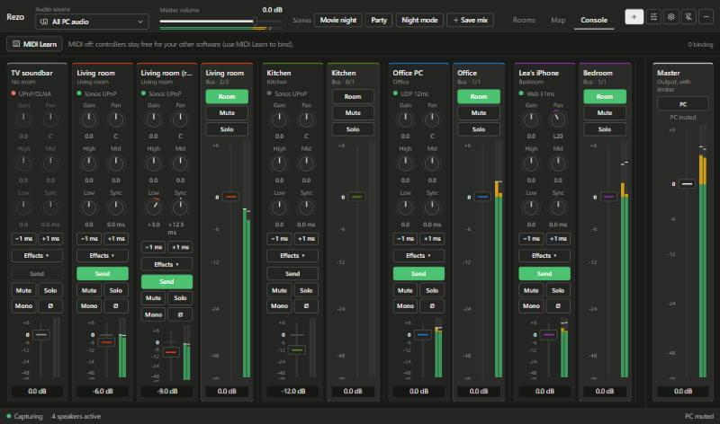
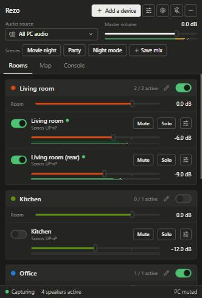

# Rezo

Rezo sends what your Windows PC is playing to the speakers around your home, all at once: Sonos, UPnP/DLNA renderers, other PCs running a small receiver, and phones or tablets through a web page. Each speaker gets its own channel strip (gain, EQ, effects, pan, delay) so rooms can be balanced and lined up by ear.



<p>
  
  
</p>

## Features

- **Sources**: everything the PC plays (WASAPI loopback) or a single application (process loopback, Windows 10 2004+).
- **Outputs**
  - Sonos and UPnP/DLNA renderers, fed with a continuous 48 kHz WAV stream over HTTP.
  - Native receivers over UDP/RTP with Opus in low-delay mode (`tools/rezo-recv`), for the lowest latency.
  - Any phone or tablet: scan a QR code, the browser becomes a speaker (WebSocket + AudioWorklet).
- **Per-speaker processing**: gain, 3-band EQ, bass boost, presence, loudness, stereo width, compressor, noise gate, pan, channel mode, phase invert, delay from -500 to +500 ms, limiter.
- **Rooms and scenes**: group speakers into rooms, save complete mixes and recall them in one click.
- **Views**: Rooms (compact tray popover), Map (drag speakers between rooms), Console (mixing desk with MIDI Learn).
- **Audio mixer window**: volume and mute for each PC output (wired, Bluetooth, HDMI, USB) and each application, and switching the default output.
- **Smart Output** (optional): mutes the PC output while network speakers play and restores that exact output afterwards.
- **French and English** interface, switchable in Settings.

## Latency

| Path | Typical delay |
|---|---|
| Native receiver (Opus over UDP) | 10 to 25 ms |
| Web browser | 40 to 150 ms, depending on the device |
| Sonos / UPnP | 1 to 3 s, imposed by the speaker's own buffering |

Sonos speakers buffer HTTP streams before playing. Rezo keeps the stream open while a speaker is enabled, so audio starts after that buffer only, without reloading.

## Download

Get the latest version from the [Releases page](https://github.com/theappstore-cell/Rezo/releases/latest):

- `Rezo_<version>_x64-setup.exe`: installer (adds a firewall rule for private networks, Start menu entry, uninstaller).
- `Rezo-<version>-portable.exe`: single executable, nothing to install.
- `rezo-recv-<version>-windows-x64.exe`: native receiver for another Windows PC.

The binaries are not code-signed yet, so Windows SmartScreen may warn on first launch ("More info" > "Run anyway").

## Requirements

- Windows 10 (2004 or later) or Windows 11, 64-bit.
- PC and speakers on the same local network. Allow Rezo on private networks when the Windows Firewall asks.

## Building

You need Rust (MSVC toolchain), the Visual Studio Build Tools with the Windows SDK, CMake and Node.js 20 or newer.

```powershell
npm install
npm run tauri build
```

The installer ends up in `src-tauri/target/release/bundle/nsis/`. For development, use `npm run tauri dev`. To get a standalone executable with a console for logs, run `cargo build --release --features console` in `src-tauri`.

The native receiver builds on Windows, macOS and Linux:

```powershell
cd tools/rezo-recv
cargo run --release -- --name "Office PC" --port 5004
```

More details on building, firewall rules and network tuning are in [docs/BUILD.md](docs/BUILD.md). The wire formats are described in [docs/PROTOCOL.md](docs/PROTOCOL.md).

## How it works

```
WASAPI loopback ──► lock-free ring ──► router (MMCSS "Pro Audio" while streaming)
                                         │  per speaker: gate → EQ → tone → compressor → width
                                         │               → pan/mode/phase → gain → delay → limiter
                                         ├──► Opus over UDP/RTP   (native receivers)
                                         ├──► WAV over HTTP       (Sonos / UPnP)
                                         └──► PCM over WebSocket  (browsers)
```

The engine is written in Rust (`src-tauri`), the interface in React and TypeScript (`src`), packaged with Tauri 2. Parameters reach the audio thread through atomics and audio moves through SPSC ring buffers, so the real-time path never locks or allocates.

When no speaker is enabled, Rezo opens no audio stream, registers no real-time task and its router thread sleeps. Audio devices, including Bluetooth headsets, can go idle normally.

## Project layout

```
src/                 React interface
src-tauri/src/
  audio/             capture, DSP, router, encoders, output switch, mixer
  network/           discovery, Sonos/UPnP, UDP streamer, web receiver, HTTP server
  state/             persistent configuration
  engine.rs          orchestration
src-tauri/web/       browser receiver page and AudioWorklet
tools/rezo-recv/     reference native receiver
docs/                build guide and protocol notes
```

## License

GPL-3.0. See [LICENSE](LICENSE).
